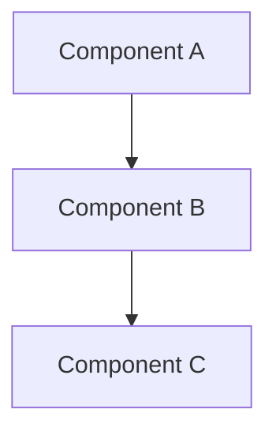

# ADR-0000: Architecture Decision Record Template

<!--
  Yarvelle Core — Domain-Neutral AI Agent Runtime & Execution Engine
  Copyright 2026 Spectrayan (https://spectrayan.com)

  Licensed under the PolyForm Noncommercial License 1.0.0 and the
  Yarvelle Core Additional Terms (see LICENSE and ADDITIONAL-TERMS.md).
  Personal and household local use only. Commercial use, hosted service
  offering, rebranding, white-labeling, and redistribution of modified
  forks are prohibited without a written commercial license from Spectrayan.

  Required Notice: Copyright 2026 Spectrayan (https://spectrayan.com)
-->

## Metadata

| Property | Value |
|---|---|
| **Status** | `Accepted` |
| **Date** | 2026-10-02 |
| **Authors** | Spectrayan Architecture Working Group (AWG) (`architecture@spectrayan.com`) |
| **Deciders** | Yarvelle Core Maintainers, Architecture Working Group |
| **Consulted** | Technical Lead & TSC Chair, Security Engineering Reviewers |
| **Informed** | Yarvelle Open-Source Community |

---

## Context & Problem Statement

Describe the context and the problem being addressed. What situation prompted this decision? What challenges or architectural limitations exist in the current implementation?

Include relevant background constraints (e.g. domain neutrality, local-first privacy, 11-layer scope isolation, memory footprint, deterministic policy gates).

---

## Decision Drivers

List the key criteria that guide this architectural choice:
- **Driver 1**: [e.g. Strict domain neutrality ("Core Knows No Domain")]
- **Driver 2**: [e.g. Local-first zero-telemetry execution]
- **Driver 3**: [e.g. Deterministic 11-layer scope isolation (`ScopeContext`)]
- **Driver 4**: [e.g. Sub-second routing latency across specialist agents]

---

## Considered Options

### Option 1: [Name of First Option]
* **Description**: Brief explanation of how this approach works.
* **Pros**:
  - Direct, simple to implement.
  - Minimal initial development overhead.
* **Cons**:
  - Poor scalability as agent catalog expands.
  - Tightly couples disparate layers.

### Option 2: [Name of Second Option]
* **Description**: Brief explanation of how this approach works.
* **Pros**:
  - Strong architectural isolation.
* **Cons**:
  - High operational complexity; requires external daemon.

### Option 3: [Name of Third Option (Chosen)]
* **Description**: Brief explanation of the selected approach.
* **Pros**:
  - Addresses all core decision drivers.
  - Clean boundary isolation with zero external runtime dependencies.
* **Cons**:
  - Requires authoring adapter interfaces and validation tests.

---

## Decision Outcome

**Chosen Option**: **Option 3: [Title of Chosen Option]**

### Justification
Explain why this option was selected over the alternatives. How does it balance the decision drivers and trade-offs?

### Architectural Diagram



---

## Consequences

### Positive Consequences
- [Advantage 1 achieved by this decision]
- [Advantage 2 achieved by this decision]

### Negative Consequences
- [Accepted trade-off or added complexity]

### Neutral / Preserved Behaviors
- [Existing interfaces or workflows that remain backward compatible]

---

## Verification & Code References

Detail the exact files, modules, and commands used to verify this decision:

- **Core Implementation**: `backend/src/yarvelle_core/...`
- **Port Interfaces**: `backend/src/yarvelle_core/memory/ports/...`
- **Unit & Integration Tests**: `backend/tests/test_...`
- **Verification Command**:
  ```bash
  PYTHONPATH=backend/src backend/.venv/bin/pytest backend/tests/test_file.py
  ```
