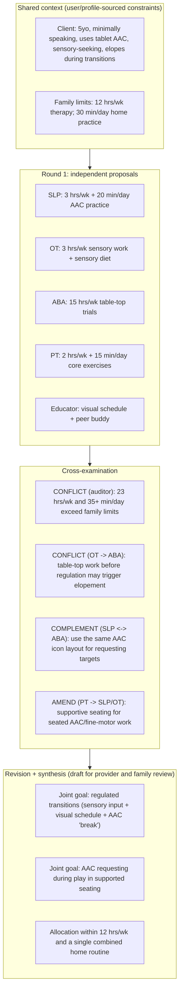

# ADR 0001: Multi-Agent Deliberation (`ExecutionMode.DELIBERATE`)

- **Status:** Proposed
- **Date:** 2026-10-24
- **Authors:** Yarvelle maintainers
- **Verified against:** `yarvelle/yarvelle-core` `main` @ `cb3813c` (tag `v0.1.1`). Line references below point at that commit and may drift as `main` moves.

---

## 1. Context

### 1.1 What the engine does today

`yarvelle-core` supports three execution topologies in [`ExecutionMode`](../../backend/src/yarvelle_core/schemas/plan.py#L29-L34):

1. **`SINGLE`**: one specialist agent handles the user turn.
2. **`PARALLEL`**: several specialists run concurrently via `asyncio.gather` ([`ExecutionDispatcher.dispatch`, parallel branch](../../backend/src/yarvelle_core/workflows/dispatcher.py#L260-L283)), with no awareness of each other's outputs.
3. **`PIPELINE`**: a one-way topologically sorted chain ([pipeline branch](../../backend/src/yarvelle_core/workflows/dispatcher.py#L284-L316)). Downstream agents receive `# PRIOR SPECIALIST OUTPUTS` as read-only context and cannot question, push back on, or revise upstream proposals.

[`ResponseSynthesizerNode.synthesize_response`](../../backend/src/yarvelle_core/workflows/nodes/response_synthesizer_node.py#L96-L161) does not call an LLM or resolve conflicts. It concatenates each specialist's markdown under `## <Specialty> Guidance` headers, with one hardcoded keyword check for a `cardio` + `nephro` fluid conflict ([L136-L148](../../backend/src/yarvelle_core/workflows/nodes/response_synthesizer_node.py#L136-L148)).

### 1.2 Why that is not enough

Some requests need several specialists to produce **one** plan, for example a multidisciplinary therapy team agreeing a care-conference agenda, or a household's cash-flow, tax and risk perspectives agreeing a 12-month budget plan. Real multidisciplinary teams and advisory committees work because specialists:

1. **Share finite constraints** (a child's tolerable therapy hours per week; a household's monthly free cash flow).
2. **Surface cross-specialty dependencies and contraindications** (sensory regulation before table-top work; a near-term medical expense that a debt-payoff plan would ignore).
3. **Challenge and revise** proposals over bounded rounds, then either converge or hand explicit trade-offs to a human.

Neither blind fan-out nor a one-way chain supports any of these.

### 1.3 Current-state evidence

| Subsystem | Current implementation (`file:line` @ `cb3813c`) | Why it blocks deliberation |
| :--- | :--- | :--- |
| **Plan schema** | [`schemas/plan.py` L29-L34](../../backend/src/yarvelle_core/schemas/plan.py#L29-L34) defines `ExecutionMode`; [`AgentTask` L37-L68](../../backend/src/yarvelle_core/schemas/plan.py#L37-L68). | No representation for rounds, shared constraints, a moderator, convergence rules or panel membership. |
| **Orchestrator routing** | [`OrchestratorDecision` L144-L170](../../backend/src/yarvelle_core/workflows/nodes/orchestrator_node.py#L144-L170) selects a single `agent_id`. Multi-agent plans in [`_route()` L570-L789](../../backend/src/yarvelle_core/workflows/nodes/orchestrator_node.py#L570-L789) rely on hardcoded health keyword tuples (`auth_keywords` at [L596](../../backend/src/yarvelle_core/workflows/nodes/orchestrator_node.py#L596), `condition_patterns` at [L734](../../backend/src/yarvelle_core/workflows/nodes/orchestrator_node.py#L734)). | Domain keywords live in core, which should know no domain, and the orchestrator cannot assemble a K-agent panel with role briefs. |
| **Execution dispatcher** | [`workflows/dispatcher.py` L248-L319](../../backend/src/yarvelle_core/workflows/dispatcher.py#L248-L319) runs each agent at most once per turn (`outputs[aid] = ...`). | Agents cannot read peer proposals, critique, answer a peer, or revise. |
| **Response synthesizer** | [`ResponseSynthesizerNode`](../../backend/src/yarvelle_core/workflows/nodes/response_synthesizer_node.py#L55-L161) has no model; [`__init__` L58](../../backend/src/yarvelle_core/workflows/nodes/response_synthesizer_node.py#L58) takes only `name`. | Cannot reconcile conflicting recommendations, merge goals, or summarize dissent. |
| **Streaming and wiring** | [`engine/service.py` L760](../../backend/src/yarvelle_core/engine/service.py#L760) builds `GraphBuilder(include_supervisor=False)`; [`NON_STREAMING_NODES` L93-L115](../../backend/src/yarvelle_core/engine/service.py#L93-L115) suppresses token streaming from `"dispatcher"`. | A multi-round deliberation inside `"dispatcher"` would emit nothing to the client until synthesis finishes. |
| **Policy gate** | [`evaluate_policy_gate` L376-L469](../../backend/src/yarvelle_core/engine/tool_exec.py#L376-L469); the taint override at [L446-L449](../../backend/src/yarvelle_core/engine/tool_exec.py#L446-L449) forces approval only when `tier == "write_external"` (irreversible is already always gated at L442-L443). | A tainted context can still run a `write_local` action without approval under A1/A2. Acceptable for a single agent, not for actions a panel stages from many agents' inputs. |

### 1.4 Architectural principles this must respect

Stated here so the ADR stands on its own:

- **Core knows no domain.** No health, finance or other domain vocabulary in `yarvelle-core`; domains arrive via packs.
- **Dependencies point inward:** app -> packs -> core. Core never imports a pack.
- **Scope isolation.** Every tool call runs inside a [`scope_context`](../../backend/src/yarvelle_core/scope/context.py#L136-L182); cross-scope reads require a declared read (`declared_reads` in the [pack protocol](../../backend/src/yarvelle_core/conformance/protocol.py#L19-L25)) plus a grant, and are audited.
- **Tool execution tiers.** Tools are `read`, `write_local`, `write_external` or `irreversible` ([`KNOWN_RISK_TIERS`](../../backend/src/yarvelle_core/engine/tool_exec.py#L373)), gated by autonomy level, monotone taint ([`TaintFlag`](../../backend/src/yarvelle_core/engine/tool_exec.py#L81-L98)), consent and age band. Unknown tiers fail closed.

---

## 2. Decision

We will add a domain-neutral **scoped blackboard deliberation engine** as a fourth topology, `ExecutionMode.DELIBERATE`, built as a bounded, cyclic LangGraph subgraph:

**Propose -> Cross-Examine -> Selective Revise -> Synthesize & Gate**

We will **not** implement free-form peer-to-peer group chat. Agents write typed objects (`AgentProposal`, `PeerCritique`) to a blackboard; every read of the blackboard is filtered by the reader's scope.

The critique step uses a structured protocol we call **Disagree-or-Commit (DoC)**: each reviewer must either commit to a peer proposal (`ENDORSE` / `COMPLEMENT`) or disagree with a concrete, typed objection (`AMEND` / `CONFLICT`). Bare agreement without content is not a valid critique.

The binding rules are in sections 2.1 to 2.9.

### 2.1 Schemas (`schemas/plan.py`)

```python
class ExecutionMode(str, Enum):
    SINGLE = "single"
    PARALLEL = "parallel"
    PIPELINE = "pipeline"
    DELIBERATE = "deliberate"  # bounded, multi-round blackboard deliberation


class SharedConstraint(BaseModel):
    """A finite resource shared across deliberating agents.

    limit_value MUST come from user- or profile-sourced data, never from a model.
    If it is unknown, it stays None and the budget check for this constraint is skipped.
    """
    id: str                                   # e.g. "weekly_time_hours", "monthly_free_cashflow"
    description: str
    unit: str                                 # e.g. "hours/week", "USD/month"; required for checking
    limit_value: Optional[float] = None
    limit_source: Optional[Literal["user", "profile"]] = None  # required when limit_value is set


class DeliberationBudget(BaseModel):
    max_rounds: int = Field(default=2, ge=1, le=4)        # Phase 1 pins this to 2 (1 revision round)
    max_wall_clock_s: float = Field(default=120.0, gt=0)  # hard stop for the whole deliberation
    max_total_tokens: int = Field(default=40_000, gt=0)   # prompt + completion across all calls


class DeliberationConfig(BaseModel):
    panel_id: Optional[str] = None
    moderator_agent_id: str = "orchestrator"
    budget: DeliberationBudget = Field(default_factory=DeliberationBudget)
    shared_constraints: List[SharedConstraint] = Field(default_factory=list)
    critique_mode: Literal["per_agent", "batched"] = "per_agent"
```

There is deliberately **no `consensus_threshold`** field (see 2.4). The budget defaults above are starting points to be tuned from evals, not measured values.

### 2.2 Blackboard state (`workflows/state.py`)

Deliberation state lives in a dedicated `deliberation_state` channel on [`AgentState`](../../backend/src/yarvelle_core/workflows/state.py#L35-L165), not in `state["messages"]`, so peer chatter neither pollutes checkpointed history nor bypasses scope filtering.

```python
class TypedClaim(BaseModel):
    """The ONLY kind of content that may cross a domain boundary (see 2.3)."""
    kind: Literal["amount", "date_window", "boolean", "quantity"]
    key: str                                  # e.g. "upcoming_out_of_pocket_expense"
    value: Union[float, bool, None] = None
    unit: Optional[str] = None                # required for amount and quantity
    window_start: Optional[date] = None       # for date_window
    window_end: Optional[date] = None
    source_scope: str                         # scope the claim was derived from
    tainted: bool = False


class StagedAction(BaseModel):
    agent_id: str
    tool_name: str
    tool_args: Dict[str, Any]
    rationale: str
    risk_tier: Literal["read", "write_local", "write_external", "irreversible"]  # taken from ToolSpec, never from the model


class AgentProposal(BaseModel):
    agent_id: str
    round_num: int
    scope: str                                # originating domain scope
    summary: str                              # free text: visible ONLY within `scope`
    recommendations: List[str] = Field(default_factory=list)          # free text: same-scope only
    resource_claims: Dict[str, float] = Field(default_factory=dict)   # keyed by SharedConstraint.id
    resource_claim_units: Dict[str, str] = Field(default_factory=dict)
    exported_claims: List[TypedClaim] = Field(default_factory=list)   # what other domains may see
    dependencies: List[str] = Field(default_factory=list)
    staged_actions: List[StagedAction] = Field(default_factory=list)
    confidence: Optional[float] = Field(default=None, ge=0.0, le=1.0)  # informational only; never drives control flow
    provenance: List[str] = Field(default_factory=list)  # tool calls / sources consulted
    tainted: bool = False                     # set by the engine from the agent's TaintFlag, not by the model


class CritiqueStance(str, Enum):
    ENDORSE = "endorse"        # commit: agree; must add at least one supporting point
    COMPLEMENT = "complement"  # commit: propose a joint or merged goal
    AMEND = "amend"            # disagree: request a modification or sequencing change
    CONFLICT = "conflict"      # disagree: direct contradiction, safety risk or budget violation


class PeerCritique(BaseModel):
    reviewer_agent_id: str
    target_agent_id: str
    round_num: int
    stance: CritiqueStance
    issue_type: Literal["resource_overbudget", "contraindication", "dependency_order", "synergy", "risk_exposure"]
    critique: str
    proposed_resolution: str
    resolved: bool = False     # set by the engine when the target's revision addresses it
```

### 2.3 Scope rules on the blackboard

1. **Same-domain panels** (all members in one domain scope): members may read every field of each other's proposals.
2. **Cross-domain panels:** only `TypedClaim` objects cross a domain boundary. **No free text crosses domains**: not `summary`, not `recommendations`, not `critique` text, not an LLM-written "summary" of another domain's data. A typed claim is an amount, a date window, a boolean or a quantity with a unit (for example "out-of-pocket expense: 3500 USD within 60 days"), so another domain learns the constraint without learning the underlying record.
3. The engine (not the model) builds each agent's view of the blackboard by filtering on the reader's scope. Cross-domain critiques may reference only the target's exported claims.
4. A cross-domain read requires the reader's pack to declare the read (`declared_reads`) and hold a grant for it. Without both, the claim is withheld and the panel is told only that a constraint exists but is not visible.
5. **Every cross-scope blackboard read emits a `scope.cross_read` audit event** (new event type) in the hash-chained audit log, recording reader agent, source scope, claim keys and round.
6. Each agent's own tool calls still run inside its own `scope_context`. A finance agent can never call a health tool because it sits on a panel with a health agent.

### 2.4 Convergence is rule-based

Deliberation ends when **either**:

- no unresolved `CONFLICT` critiques remain, **or**
- `max_rounds` is reached, **or**
- the wall-clock or token budget is exhausted (2.7).

Self-reported `confidence` never decides convergence or weighting. LLM self-scores are poorly calibrated, so `confidence` is optional, defaults to `None`, and is shown only as information. Unresolved `AMEND` critiques do not block convergence; they are listed for the human.

### 2.5 Constraint budget checks

- A deterministic auditor sums `resource_claims` per `SharedConstraint` and raises a `resource_overbudget` `CONFLICT` when the sum exceeds `limit_value`.
- `limit_value` comes **only** from user input or profile data (`limit_source` in `{"user", "profile"}`). A model may never estimate or fill in a limit.
- If `limit_value` is unknown, the check for that constraint is **skipped**, and the synthesizer says the plan was not checked against that constraint.
- Units must match: a claim whose unit differs from the constraint's unit fails validation; the engine does not guess conversions.

### 2.6 Staged actions and taint

- **Every action a panel stages requires human approval, regardless of tier or autonomy level.** Panel-staged actions are routed through [`execute_tool_call`](../../backend/src/yarvelle_core/engine/tool_exec.py#L601) with approval forced, so `write_local` from a panel is gated even under A1/A2. The existing single-agent gate is unchanged.
- **No tool writes during deliberation.** During Propose and Revise, agents may call `read` tools only; writes are only ever *staged* for the final gate. (Phase 1 drops staged actions entirely; see section 7.)
- **Taint is tracked per proposal.** The engine sets `AgentProposal.tainted` from the agent's `TaintFlag` and records `provenance`. A typed claim derived from a tainted proposal is itself tainted. The run-level taint remains monotone: once any proposal is tainted, the deliberation context is tainted.
- The synthesizer must **flag any recommendation that rests on a tainted proposal or claim** ("based partly on content from an untrusted source"), so the human can weigh it.

### 2.7 Budgets and failure handling

- **Budgets:** `max_rounds`, `max_wall_clock_s` and `max_total_tokens` are all enforced. On exhaustion the engine stops starting new calls, lets in-flight calls finish or cancels them at the wall-clock limit, and synthesizes from what is on the blackboard, marking the result as "deliberation cut short".
- **Schema-validation failure:** an agent whose output fails validation gets at most one repair retry. If it still fails, the panel **continues without it**, and the synthesizer states that the agent's perspective is missing. If fewer than two valid proposals remain, the engine falls back to presenting the valid output as a single-agent answer with that note.
- **User cancellation mid-round:** in-flight calls are cancelled, no staged actions are created, nothing is written, and the partial blackboard is checkpointed so the thread history shows the deliberation was cancelled.
- **Approval interrupt and resume:** the final gate uses the existing LangGraph `interrupt` path in [`tool_node.py`](../../backend/src/yarvelle_core/workflows/nodes/tool_node.py). The blackboard is checkpointed before the interrupt; on resume (via the existing `Command` resume path in [`engine/service.py`](../../backend/src/yarvelle_core/engine/service.py#L1075)) the engine continues from the checkpoint and **does not re-run any deliberation round**. Approvals bind to the exact staged tool name and arguments.

### 2.8 Critique modes

- **`per_agent` (default):** each reviewer critiques peers in its own call.
- **`batched` (optional, local-model mode):** one structured-output call produces the full critique matrix. This saves calls on local hardware, but a single critic acts as a moderator and risks reintroducing the sycophancy and averaging DoC is meant to prevent. It ships behind config and must be measured against `per_agent` on the same golden evals before it becomes a default anywhere.

### 2.9 Panels in packs, and routing

Core does not know which agents form a therapy team or a finance committee; packs declare it. We extend [`PackProvidesSpec`](../../backend/src/yarvelle_core/pack/spec.py#L110-L123) with an optional `panels:` list.

```yaml
# Illustrative: a therapy-domain pack's pack.yaml
provides:
  panels:
    - id: developmental-therapy-panel
      title: Multidisciplinary Therapy Care Conference (prep)
      description: Draft goal matrix across speech, occupational, behavioral and physical therapy and special education, for provider and family review.
      agents: [slp-guide, ot-guide, aba-guide, pt-guide, iep-educator]   # agents from THIS pack
      max_rounds: 2
      default_constraints:
        - id: weekly_therapy_hours
          description: Total weekly direct therapy hours tolerable for the client
          unit: hours/week
        - id: daily_caregiver_minutes
          description: Daily home-practice time available to caregivers
          unit: minutes/day
```

```yaml
# Illustrative: a finance-domain pack's pack.yaml
provides:
  panels:
    - id: household-financial-committee
      title: Household Financial Scenario Review
      description: Cash-flow/debt, tax/retirement and risk/protection perspectives on a 12-month scenario, for household review.
      agents: [cashflow-debt-advisor, tax-retirement-advisor, risk-protection-advisor]
      max_rounds: 2
      default_constraints:
        - id: monthly_free_cashflow
          description: Net monthly cash available for allocation
          unit: USD/month
        - id: liquidity_floor_months
          description: Minimum liquid reserve in months of essential expenses
          unit: months
```

Rules:

- **No new `trigger_patterns` keyword lists.** Panel selection reuses the existing declarative routing hints (`PackProvidesSpec.routing`, [L119](../../backend/src/yarvelle_core/pack/spec.py#L119), and [`RoutingHints`](../../backend/src/yarvelle_core/schemas/routing.py) / `PackSpec.routing_hints`). Hints are inputs the LLM orchestrator **confirms**, never automatic triggers. Moving the existing hardcoded keywords out of `_route()` is part of this work.
- **Panel membership is pack-scoped.** A panel may list only agents its own pack contributes. Placing another pack's agent on a panel requires an explicit grant for that pack pairing; without it, the panel fails validation at load time.
- Constraint `default_constraints` declare *which* constraints exist and their units, never their limits. Limits come from the user or profile at run time (2.5).
- The orchestrator may also assemble an **ad-hoc panel** of 2 to 5 registered specialists when a request clearly spans specialties with competing trade-offs, under the same membership, scope and grant rules.
- **Complexity tiering** (after MDAgents): simple requests stay `SINGLE`; independent sub-questions use `PARALLEL` or `PIPELINE`; only trade-off-heavy requests use `DELIBERATE`.

### 2.10 Subgraph

```mermaid
stateDiagram-v2
    [*] --> CharterAndConstraints
    CharterAndConstraints --> Propose: frame problem, load user/profile limits

    state Propose {
        [*] --> Specialist_1
        [*] --> Specialist_2
        [*] --> Specialist_K
    }
    note right of Propose: read-only tools; writes are never executed here

    Propose --> CrossExamine: AgentProposals on blackboard (scope-filtered views)

    state CrossExamine {
        [*] --> BudgetAuditor: deterministic sum vs user/profile limits (skip if unknown)
        [*] --> PeerCritiques: Disagree-or-Commit
    }

    CrossExamine --> ConvergenceGate
    state ConvergenceGate <<choice>>
    ConvergenceGate --> SelectiveRevise: open CONFLICT and round < max_rounds and budget left
    ConvergenceGate --> Synthesize: no open CONFLICT, or max_rounds, or budget exhausted

    state SelectiveRevise {
        [*] --> TargetedSpecialistsOnly
    }
    note right of SelectiveRevise: only agents targeted by open CONFLICT/AMEND re-run

    SelectiveRevise --> CrossExamine: round_num + 1
    Synthesize --> GateAndGuardrail: plan + trade-offs + minority report + staged actions
    GateAndGuardrail --> [*]
```



**Selective revision:** only agents targeted by open `CONFLICT` or `AMEND` critiques re-run. Agents with no open critiques keep their proposal, which keeps the call count well below N x R.

### 2.11 Synthesis and output

`ResponseSynthesizerNode` gains an optional `model`. When `deliberation_state` is present it produces:

1. **Unified plan** (joint goals, or a time-phased scenario).
2. **Resource table** showing each checked constraint, and listing constraints that were not checked because no limit was known.
3. **Trade-offs:** why initial proposals changed.
4. **Minority report:** if agents still disagree at the end, the output presents **Option A vs. Option B** with each side's rationale, and the human makes the value judgment. Convergence is never forced unanimity.
5. **Untrusted-input flags** for any advice resting on tainted proposals.
6. **Staged actions** as approval cards (Phase 3 only).

Every synthesized output passes through [`OutputGuardrailNode`](../../backend/src/yarvelle_core/workflows/nodes/output_guardrail_node.py), applying the union of all participating packs' `SafetyPolicy` rules.

**Non-clinical, non-fiduciary framing:** outputs are framed as preparation material for review by the user and their professionals, for example "Care conference prep: draft goal matrix (for provider and family review)" or "Financial scenario (for household review)". They are never presented as a treatment plan, prescription, or investment, tax or legal advice.

### 2.12 Streaming events

Deliberation emits custom events via `adispatch_custom_event` (already used in [`engine/builder.py`](../../backend/src/yarvelle_core/engine/builder.py#L429)), with constants added next to the existing `SSE_EVENT_*` values in [`constants/api.py`](../../backend/src/yarvelle_core/constants/api.py#L159-L168). Payloads are filtered per scope exactly like blackboard reads.

| Event | Payload | UI |
| :--- | :--- | :--- |
| `panel_start` | `{panel_id, title, agents, shared_constraints}` | Panel header with members and constraint pills. |
| `deliberation_proposal` | `{round, agent_id, summary, resource_claims, tainted}` | Each specialist's position card as it finishes. |
| `deliberation_critique` | `{round, reviewer_id, target_id, stance, issue_type, critique}` | Connectors such as "OT -> ABA: sensory prerequisite". |
| `deliberation_revision` | `{round, agent_id, summary, resolved_critiques}` | "Revised after peer review" badge. |
| `deliberation_end` | `{reason: "converged" \| "max_rounds" \| "budget" \| "cancelled", rounds_used, open_conflicts, missing_agents}` | Status before the synthesized plan streams. No synthetic "consensus score". |

---

## 3. Illustrative scenarios

> **Illustrative examples only.** These scenarios show the mechanics of deliberation. They are not clinical, financial, tax or legal advice, the numbers are invented, and they must not be quoted as product results.

### 3.1 Scenario A: therapy care-conference prep (same-domain panel)

A 5-year-old client; five specialist agents (speech, occupational, behavioral, physical therapy, special education) prepare a 90-day draft goal matrix. Family-provided constraints: at most 12 hours/week of direct therapy, 30 minutes/day of caregiver home practice.



Without deliberation (`PARALLEL`), the family receives five separate checklists totalling about 23 hours/week. With deliberation, the auditor flags the over-allocation against family-provided limits, peers surface the sequencing and seating dependencies, and only the targeted agents revise.

### 3.2 Scenario B: household financial scenario (cross-domain panel)

Three finance-domain agents review a household scenario. One input comes from the health domain, and it crosses only as a typed claim.

Inputs (invented): monthly free cash flow **$1,800** (user-provided); credit card balance $14,000 at 22.9% APR; auto loan $28,000 at 6.5%; emergency fund 1.8 months; salary $100,000/yr with an employer 401(k) match of 50% on contributions up to 6% of pay, so contributing **$500/month** (6%) captures a **$250/month** match, currently uncaptured.

Health-domain input, exported as a typed claim only:

```json
{"kind": "amount", "key": "upcoming_out_of_pocket_expense", "value": 3500, "unit": "USD",
 "source_scope": "health.paperwork", "tainted": false}
{"kind": "date_window", "key": "upcoming_out_of_pocket_expense_due",
 "window_start": "2026-11-01", "window_end": "2026-12-23", "source_scope": "health.paperwork"}
```

The finance agents never see the diagnosis, provider or record behind it. Reading these claims emits `scope.cross_read`.

```mermaid
sequenceDiagram
    autonumber
    participant BB as Blackboard (scope-filtered)
    participant A1 as Cash-flow & debt
    participant A2 as Tax & retirement
    participant A3 as Risk & protection
    participant Mod as Synthesizer / gate

    Note over BB: Free cash flow $1,800/mo (user) | CC $14k @ 22.9% | 401(k): $500/mo captures $250/mo match | Typed claim: $3,500 expense within ~60 days
    par Round 1: proposals
        A1->>BB: $1,800/mo to the credit card (highest APR first); pause investing
        A2->>BB: $500/mo 401(k) for the full match + $650/mo HSA (pre-tax)
        A3->>BB: $1,500/mo to a liquid reserve for the $3,500 expense and a 3-month floor
    end
    Note over BB: Auditor CONFLICT: $4,450/mo claimed vs $1,800/mo limit
    par Cross-examination (Disagree-or-Commit)
        A1->>A2: COMPLEMENT: the match is an immediate 50% on contributions; keep $500/mo 401(k)
        A3->>A1: CONFLICT: paying the card down before the expense likely puts $3,500 back on the 22.9% card
        A2->>A3: AMEND: if HSA-eligible, fund the expense reserve through the HSA (pre-tax) and reimburse the qualified expense
    end
    Mod->>BB: Synthesis (scenario for household review)
    Note over Mod,BB: Months 1-2: $500 401(k) + $580 HSA + $720 card = $1,800<br/>Months 3-12: $500 401(k) + $1,300 card = $1,800<br/>Payoff timeline not computed here; minority view (faster payoff vs larger buffer) shown as Option A / B
```

The point is the mechanism: because the expense crossed as a typed claim, the tax and risk agents found an option neither proposed alone (fund the reserve pre-tax through an HSA, if eligible) while staying within the user's $1,800/month. Exact tax effects depend on the household and are deliberately not quantified.

---

## 4. Consequences

**Positive**

- Multi-specialist requests get one reconciled plan with explicit trade-offs and a minority report, instead of concatenated checklists.
- Bounded cost: O(N x R) calls with selective revision, versus quadratic transcript growth in group chat.
- Scope isolation and taint survive multi-agent interaction: cross-domain exchange is limited to typed claims, audited per read, and every panel-staged action is human-approved.
- Removes hardcoded domain keywords from core routing.
- Makes deliberation visible to the user through streaming events.

**Negative / costs**

- More LLM calls and latency per deliberated turn. Rough, **unmeasured** estimate for a 5-agent panel with 2 rounds on a local 7-14B model: tens of seconds to over a minute. Actual concurrency on Ollama depends on `OLLAMA_NUM_PARALLEL` and available memory; requests beyond that queue. Must be measured before any latency claim.
- Small local models may produce invalid `PeerCritique` / `AgentProposal` JSON; repair retries and partial-panel handling add complexity.
- Typed-claim-only crossing limits what cross-domain panels can express; some useful nuance will not cross.
- Forced approval for all panel-staged actions adds friction, even for low-risk local writes.
- New schema surface (`panels:`, `DeliberationConfig`) becomes part of the pack API and must be versioned.

---

## 5. Alternatives considered

| Option | How it works | Why not (or where used) |
| :--- | :--- | :--- |
| **Free-form group chat** (AutoGen-style shared transcript with speaker selection) | All agents share one message list. | Rejected. Transcript grows with every turn; small models drift from their role over long transcripts; prone to polite agreement; per-agent scope isolation is impossible on a shared history; termination is hard to guarantee. |
| **Structured blackboard roundtable** | Typed proposals and critiques on shared state, discrete rounds. | **Adopted** as the core engine. Bounded, parallel within a round, schema-validated, filterable per scope. |
| **Adversarial debate / critic loop** | Proposals must survive structured critique. | **Adopted inside Cross-Examine** as Disagree-or-Commit, with a hard round cap so "always object" critics cannot prevent termination. |
| **Constraint-budget negotiation** | Sum claims against shared limits, force trade-offs. | **Adopted** as the deterministic auditor, with limits from user/profile only. |
| **Confidence-weighted voting / consensus threshold** | Stop or weight by models' self-reported confidence. | Rejected. Self-reported confidence is poorly calibrated; convergence is rule-based instead. |
| **Single moderator call that critiques everything** | One LLM call reviews all proposals. | Kept only as the optional `batched` local mode, pending evals. |
| **Extend `PIPELINE` with back-edges** | Let downstream agents send notes upstream. | Rejected. Ordering bias, no shared constraint view, and it complicates the existing DAG semantics. |

---

## 6. Open questions

1. Default wall-clock and token budgets per provider (local vs. hosted) once measured.
2. Whether `quantity` and `amount` should share one claim kind with a unit registry, and who owns the unit vocabulary (core neutral units vs. pack-declared units).
3. Grant model for cross-pack panel membership: per panel, per pack pair, or per user.
4. Whether a cross-domain panel needs per-turn user consent in addition to the pack's declared read and grant.
5. How the synthesizer should phrase untrusted-input flags so they are noticed but not alarming.
6. Whether `batched` critique ever meets the bar to be a local default.
7. Retention of `deliberation_state` in checkpoints, and whether the audit log stores claim values or only claim keys.

---

## 7. Implementation phases

**Phase 1: single-domain `DELIBERATE`**

- `ExecutionMode.DELIBERATE`, schemas in 2.1 and 2.2, blackboard channel.
- Same-domain panels only (all members share one scope). Cross-domain panels are rejected at validation.
- Exactly one revision round (`max_rounds = 2`), wall-clock and token budgets, schema-failure / cancellation handling.
- **No tool writes from panels**: read tools only, no staged actions.
- Rule-based convergence; deterministic budget auditor with user/profile limits only.
- Synthesizer with optional model, minority report, untrusted-input flags.
- Panel manifests in `PackProvidesSpec`, routing via existing hints; remove hardcoded domain keywords from `_route()`.
- **Golden evals on a local model**, including `per_agent` vs. `batched` critique and invalid-JSON rates.

**Phase 2: streaming and UI**

- Events in 2.12 and constants in `constants/api.py`; stop treating deliberation as a silent dispatcher step.
- `@yarvelle/ui` roundtable component: proposals, critiques, constraint meters, minority report.

**Phase 3: cross-domain panels and staged actions**

- Only after the typed-claims design (2.3) is reviewed and landed: `TypedClaim` export, scope-filtered views, `scope.cross_read` audit events, `declared_reads` + grant enforcement, cross-pack membership grants.
- Staged actions with forced approval for every panel-staged action, checkpointed resume after the approval interrupt.

---

## 8. References

**Code (`yarvelle-core` @ `cb3813c`)**

- [`backend/src/yarvelle_core/schemas/plan.py`](../../backend/src/yarvelle_core/schemas/plan.py): `ExecutionMode`, `AgentTask`, `ExecutionPlan`
- [`backend/src/yarvelle_core/workflows/state.py`](../../backend/src/yarvelle_core/workflows/state.py): `AgentState`
- [`backend/src/yarvelle_core/workflows/dispatcher.py`](../../backend/src/yarvelle_core/workflows/dispatcher.py): `ExecutionDispatcher`
- [`backend/src/yarvelle_core/workflows/nodes/orchestrator_node.py`](../../backend/src/yarvelle_core/workflows/nodes/orchestrator_node.py): `OrchestratorNode`, `_route()`
- [`backend/src/yarvelle_core/workflows/nodes/response_synthesizer_node.py`](../../backend/src/yarvelle_core/workflows/nodes/response_synthesizer_node.py): `ResponseSynthesizerNode`
- [`backend/src/yarvelle_core/workflows/nodes/output_guardrail_node.py`](../../backend/src/yarvelle_core/workflows/nodes/output_guardrail_node.py): `OutputGuardrailNode`
- [`backend/src/yarvelle_core/workflows/nodes/tool_node.py`](../../backend/src/yarvelle_core/workflows/nodes/tool_node.py): approval interrupt
- [`backend/src/yarvelle_core/engine/builder.py`](../../backend/src/yarvelle_core/engine/builder.py): `GraphBuilder`
- [`backend/src/yarvelle_core/engine/service.py`](../../backend/src/yarvelle_core/engine/service.py): execution service, `NON_STREAMING_NODES`
- [`backend/src/yarvelle_core/engine/tool_exec.py`](../../backend/src/yarvelle_core/engine/tool_exec.py): `execute_tool_call`, `evaluate_policy_gate`, `TaintFlag`, `UntrustedResult`
- [`backend/src/yarvelle_core/pack/spec.py`](../../backend/src/yarvelle_core/pack/spec.py): `PackProvidesSpec`, `PackSpec`
- [`backend/src/yarvelle_core/schemas/routing.py`](../../backend/src/yarvelle_core/schemas/routing.py): `RoutingHints`
- [`backend/src/yarvelle_core/scope/context.py`](../../backend/src/yarvelle_core/scope/context.py): `ScopeContext`, `scope_context`
- [`backend/src/yarvelle_core/conformance/protocol.py`](../../backend/src/yarvelle_core/conformance/protocol.py): `owned_scopes`, `declared_reads`

**Literature**

- Kim et al., *MDAgents: An Adaptive Collaboration of LLMs for Medical Decision-Making*, NeurIPS 2024. [arXiv:2404.15155](https://arxiv.org/abs/2404.15155). Complexity-based choice between a solo agent and team structures.
- Chen, Saha and Bansal, *ReConcile: Round-Table Conference Improves Reasoning via Consensus among Diverse LLMs*, ACL 2024. [arXiv:2309.13007](https://arxiv.org/abs/2309.13007). Multi-round roundtable with a round cap (and confidence-weighted voting, which this ADR deliberately does not adopt).
- Tang et al., *MedAgents: Large Language Models as Collaborators for Zero-shot Medical Reasoning*, Findings of ACL 2024. [arXiv:2311.10537](https://arxiv.org/abs/2311.10537). Role-played multidisciplinary discussion iterated to agreement.
- Yu et al., *FinCon: A Synthesized LLM Multi-Agent System with Conceptual Verbal Reinforcement for Enhanced Financial Decision Making*, NeurIPS 2024. [arXiv:2407.06567](https://arxiv.org/abs/2407.06567). Manager-analyst hierarchy with a risk-control component; reduced peer-to-peer communication.
- Xiao, Sun, Luo and Wang, *TradingAgents: Multi-Agents LLM Financial Trading Framework*, arXiv, December 2024. [arXiv:2412.20138](https://arxiv.org/abs/2412.20138). Role-specialized agents with structured bull/bear debate and a risk team.
- Yang et al., *FinCom: A Financial Multi-Agent Demo with Disagree-or-Commit Deliberation*, arXiv, 2026. [arXiv:2606.00939](https://arxiv.org/abs/2606.00939). Origin of the Disagree-or-Commit prompt rule (agents must critique or commit with new evidence). It reports gains on the authors' internal tasks but a lower score than plain committee coordination on an external benchmark, which is one reason this ADR requires local evals before tuning defaults.
