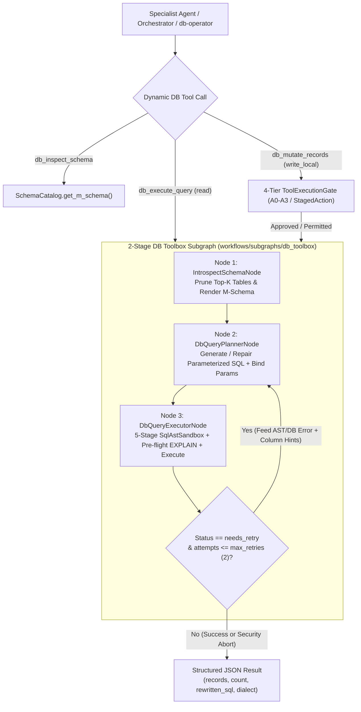
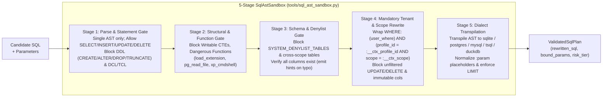
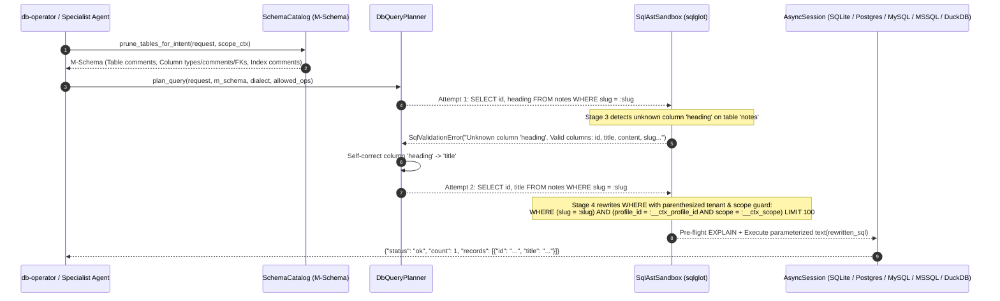
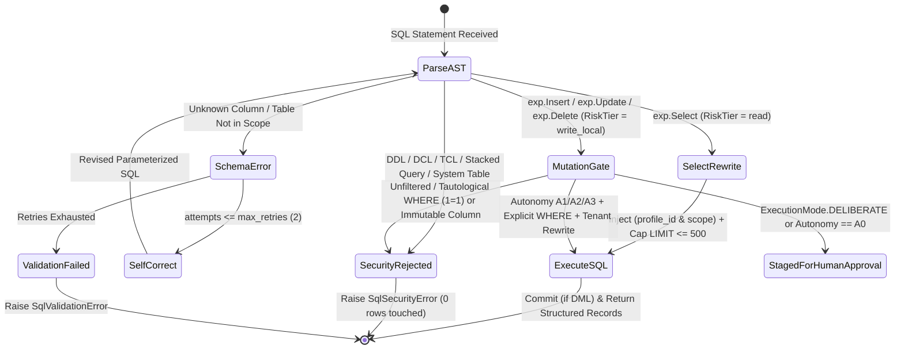

# ADR-0002: Dynamic Multi-Dialect MCP Database Toolbox, M-Schema Catalog, and AST Sandbox

<!--
  Yarvelle Core — Domain-Neutral AI Agent Runtime & Execution Engine
  Copyright 2026 Spectrayan (https://spectrayan.com)

  Licensed under the PolyForm Noncommercial License 1.0.0 and the
  Yarvelle Core Additional Terms (see LICENSE and ADDITIONAL-TERMS.md).
  Personal and household local use only. Commercial use, hosted service
  offering, rebranding, white-labeling, and redistribution of modified
  forks are prohibited without a written commercial license from Spectrayan.

  Required Notice: Copyright 2026 Spectrayan (https://spectrayan.com)
-->

## Metadata

| Property | Value |
|---|---|
| **Status** | `Accepted (Implemented)` |
| **Date** | 2026-10-25 |
| **Authors** | Spectrayan Architecture Working Group (AWG) (`architecture@spectrayan.com`) |
| **Deciders** | Yarvelle Core Maintainers, Architecture Working Group |
| **Consulted** | Technical Lead & TSC Chair, Security Engineering Reviewers |
| **Informed** | Yarvelle & Carefold Open-Source Communities |
| **Related** | [ADR-0001](0001-multi-agent-deliberation.md) (Multi-Agent Deliberation), [ADR-0003](0003-orchestrator-driven-agent-architecture.md) (Orchestrator Lifecycle), [ADR-0006](0006-policy-approvals-and-resume.md) (Policy Approvals & 4-Tier Gate) |

---

## Context & Problem Statement

`yarvelle-core` provides a Model Context Protocol (MCP) database toolbox (`yarvelle_core/tools/mcp_db_toolbox.py`) and declarative manifest (`yarvelle_core/resources/db_tools.yaml`) that expose structured relational database operations as LangChain `StructuredTool`s and `ToolSpec`s.

In the initial implementation, the database toolbox had four major architectural limitations:

1. **Static Predefined Queries Only**: Agents could only execute the exact SQL statements pre-authored in `db_tools.yaml`. Any ad-hoc analytical query, multi-table join, filtered aggregation, or dynamic record update across core or domain-pack tables required authoring new YAML tools and code hooks.
2. **SQLite-Only Coupling**: `db_tools.yaml` hardcoded `kind: sqlite-sql` and `source: carefold-sqlite`, while `session.py` only normalized `sqlite://` and `postgresql://` URLs. Downstream deployments require seamless execution across **SQLite**, **PostgreSQL**, **MySQL/MariaDB**, **SQL Server (T-SQL)**, and **DuckDB**.
3. **Missing Database Schema Documentation for Agents**: SQLAlchemy models across `yarvelle-core` and domain packs lacked table-level (`Table.comment`), column-level (`Column.comment`), and index-level (`Index.comment`) metadata, leaving query-planning agents without semantic descriptions of tables, columns, foreign keys, or access-path indexes.
4. **Unacceptable Risk of Raw Text-to-SQL**: Allowing an LLM to generate raw SQL without a deterministic Abstract Syntax Tree (AST) firewall risks destructive DDL execution (`CREATE`, `ALTER`, `DROP`, `TRUNCATE`), stacked-query SQL injection (`;`), cross-tenant data leakage (omitting `profile_id` or `scope` predicates, or bypassing them via `OR 1=1`), and unauthorized reads of system/vault tables (`users`, `credentials`, `profile_keys`, `audit_events`).

---

## Decision Drivers

- **Dynamic DML & DQL with Zero DDL**: Support dynamic query planning and execution for `SELECT`, `INSERT`, `UPDATE`, and `DELETE` across any authorized table while deterministically blocking all DDL (`CREATE`, `ALTER`, `DROP`, `TRUNCATE`, `RENAME`) and DCL/TCL/Admin statements (`GRANT`, `REVOKE`, `PRAGMA`, `ATTACH`, `DETACH`, `VACUUM`, `SET`, `COPY`, stacked queries).
- **Mandatory AST-Rewritten Tenant & Scope Isolation**: Never trust the LLM to supply or preserve `WHERE profile_id = ... AND scope = ...`. Every `SELECT`, `INSERT`, `UPDATE`, and `DELETE` AST must be deterministically rewritten to bind `:__ctx_profile_id` and `:__ctx_scope` from the trusted runtime `ToolContext` / `ScopeContext`.
- **Multi-Dialect SQL Portability**: Parse and transpile parameterized SQL statements dynamically across `sqlite`, `postgres`, `mysql`, `tsql`, and `duckdb` while preserving `:param` named placeholders for `sqlalchemy.text()`.
- **100% Schema Documentation Coverage (M-Schema)**: Every table, column, and index in `yarvelle-core` and domain packs must carry rich semantic comments rendered as compact **M-Schema** blocks for LLM query planning.
- **Strict Domain Neutrality**: `yarvelle-core`'s `mcp_db_toolbox.py` and `db_tools.yaml` must contain zero clinical, financial, or other domain-specific vocabulary (`test_neutral_words_scan.py`).

---

## Considered Options

### Option 1: Static YAML-Only Queries (`db_tools.yaml`)
* **Description**: Continue requiring every database operation to be pre-declared as a static SQL template in `db_tools.yaml`.
* **Pros**:
  - Zero runtime SQL generation overhead.
  - Simple parameter validation.
* **Cons**:
  - Cannot answer ad-hoc analytical queries, aggregations, or flexible filters across pack tables.
  - Scales poorly as new domain packs add tables and columns.

### Option 2: Unconstrained Single-Agent Text-to-SQL with Regex Blocklists
* **Description**: Give specialist agents a raw `execute_sql(query: str)` tool backed by regular-expression checks (e.g., blocking strings matching `DROP|ALTER|CREATE`).
* **Pros**:
  - Minimal implementation effort.
* **Cons**:
  - **Critically insecure**: Regex filters are trivially bypassed via comments, stacked queries, CTEs, or `OR 1=1` tautologies.
  - Fails to guarantee `profile_id` and `scope` isolation across joined tables and subqueries.
  - Pollutes every specialist agent's context window with the entire database schema.

### Option 3: Dedicated `db-operator` System Agent + 2-Stage M-Schema Planner & 5-Stage `sqlglot` AST Sandbox Subgraph (Selected)
* **Description**: Combine:
  1. **100% Table/Column/Index Comment Coverage + `SchemaCatalog` (M-Schema)** with scope filtering and keyword-scored table pruning.
  2. **5-Stage `SqlAstSandbox` (`sqlglot`)** enforcing a strict `{SELECT, INSERT, UPDATE, DELETE}` AST allowlist, system/vault table denylist, parenthesized `profile_id` + `scope` predicate injection, and multi-dialect transpilation.
  3. **2-Stage LangGraph Subgraph (`DbQueryPlanner` $\rightarrow$ `DbQueryExecutor`)** with `EXPLAIN` pre-flight validation and bounded 2-retry self-correction on schema/column errors, exposed via three dynamic tools (`db_inspect_schema`, `db_execute_query`, `db_mutate_records`) and a dedicated `db-operator` system agent.
* **Pros**:
  - Provably blocks all DDL, DCL, TCL, stacked queries, and cross-profile/cross-scope leaks at the AST level.
  - Automatically transpiles SQL across SQLite, PostgreSQL, MySQL/MariaDB, SQL Server, and DuckDB.
  - Keeps specialist agent context windows lean via intent-based M-Schema pruning and `db-operator` delegation.
  - Integrates natively with `yarvelle-core`'s 4-tier `ToolExecutionGate` (`read` vs `write_local`) and `DeliberationEngine` (`StagedAction` human approval).
* **Cons**:
  - Adds `sqlglot` AST parsing and rewrite pass (~1–2 ms per query).

---

## Decision Outcome

**Chosen Option**: **Option 3: Dedicated `db-operator` System Agent + 2-Stage M-Schema Planner & 5-Stage `sqlglot` AST Sandbox Subgraph**

### Justification

Option 3 satisfies every security, portability, and usability requirement without compromising `yarvelle-core`'s 11-layer scope isolation or 4-tier policy gate. By separating **probabilistic query planning** (`DbQueryPlanner` using pruned M-Schema documentation) from **deterministic AST validation and tenant rewriting** (`SqlAstSandbox`), an LLM can dynamically construct rich `SELECT`, `INSERT`, `UPDATE`, and `DELETE` queries across any SQL dialect while remaining mathematically unable to execute DDL, touch vault/auth tables, or access rows outside the active `profile_id` and `scope`.

### Architectural Diagrams

#### 1. End-to-End Dynamic DB Toolbox & LangGraph Subgraph Topology



#### 2. 5-Stage `SqlAstSandbox` Deterministic Security Pipeline



#### 3. Sequence Diagram: Query Planning, AST Rewriting, and Self-Correction Loop



#### 4. State Diagram: Dynamic Statement Classification & Policy Gate Lifecycle



---

### Technical Specifications

#### 1. Table, Column, & Index Comment Synchronization (`db/base.py`, `db/schema_catalog.py`)
- `ensure_table_comments()` and an automatic SQLAlchemy `@event.listens_for(Base, "instrument_class", propagate=True)` hook synchronize `Column.doc` $\leftrightarrow$ `Column.comment`, populate `Table.comment` from `__table_args__["comment"]` or the model docstring, and attach descriptive `comment` metadata to every single-column and composite `Index`.
- `SchemaCatalog.get_m_schema()` renders compact **M-Schema** blocks:
  ```text
  【DB_ID】 yarvelle_db (dialect: postgres)
  【Schema】
  # Table: notes (Workspace notes, preparation checklists, and structured scratchpads)
  [
    (id:VARCHAR(36), Primary Key, NOT NULL, Auto-Injected, Unique identifier for the note record),
    (profile_id:VARCHAR(36), NOT NULL, Auto-Injected, FK -> profiles.id, Owning profile identifier),
    (scope:VARCHAR(64), NOT NULL, Auto-Injected, Domain scope tag isolating the note),
    (slug:VARCHAR(255), NOT NULL, URL-safe unique slug identifier within the profile),
    (title:VARCHAR(255), NOT NULL, Human-readable title of the workspace note),
    (content:TEXT, NOT NULL, Markdown body content of the workspace note)
  ]
  # Indexes on notes:
  # - ix_notes_profile_slug (columns: profile_id, slug) — Composite lookup index for resolving a profile note by slug
  ```

#### 2. Multi-Dialect Support (`db/session.py`, `resources/db_tools.yaml`)
- `normalize_database_url()` normalizes `sqlite`, `postgres`/`postgresql`, `mysql`/`mariadb`, `mssql`/`sqlserver`, and `duckdb` connection strings.
- `db_tools.yaml` uses dialect-agnostic `kind: sql` and registers multi-dialect sources (`yarvelle-db`, `yarvelle-sqlite`, `yarvelle-postgres`, `yarvelle-mysql`, `yarvelle-mssql`, `yarvelle-duckdb`).

#### 3. AST Rewriting Rules (`tools/sql_ast_sandbox.py`)
- **`SELECT`**: Wraps any user `WHERE` clause in parentheses `(user_where) AND (profile_id = :__ctx_profile_id AND scope = :__ctx_scope)` across every `FROM` and `JOIN` table, and caps `LIMIT` (`default=100`, `max=500`).
- **`INSERT`**: Permits only single-row `INSERT INTO <table> (<cols>) VALUES (...)`. Overwrites/injects `:__ctx_profile_id`, `:__ctx_scope`, `:__ctx_id`, `:__ctx_now`, and populates scalar defaults from `SchemaCatalog` for any omitted non-nullable columns.
- **`UPDATE` / `DELETE`**: Rejects mutations on `READ_ONLY_TABLES` and `IMMUTABLE_COLUMNS` (`id`, `profile_id`, `user_id`, `scope`, `created_at`), rejects missing or tautological `WHERE` clauses (`WHERE 1=1`, `WHERE 'a'='a'`, `OR 1=1`), and appends parenthesized `profile_id` and `scope` guards.

---

## Consequences

### Positive Consequences
- **Zero DDL & Zero Cross-Tenant Leakage**: Deterministic AST validation and rewriting guarantee that agents can only execute scoped `SELECT`, `INSERT`, `UPDATE`, and `DELETE` operations on authorized tables.
- **Database Engine Portability**: Queries authored in standard SQLite/ANSI syntax are automatically transpiled to PostgreSQL, MySQL/MariaDB, SQL Server, or DuckDB.
- **Self-Documenting Schema & Self-Correcting Queries**: 100% comment coverage across all tables, columns, and indexes enables accurate zero-shot query planning and automatic recovery from column-name typos within 2 retries.
- **100% Domain-Neutral Core**: Removed all legacy clinical tool definitions from `yarvelle-core/backend/src/yarvelle_core/resources/db_tools.yaml` and removed `tools/mcp_db_toolbox.py` from the `test_neutral_words_scan.py` allowlist.

### Negative Consequences
- **AST Parsing Dependency**: Introduces `sqlglot>=25.0.0` as a core backend dependency (~1–2 ms parsing overhead per dynamic query).
- **Single-Row Mutation Constraint**: Dynamic `INSERT` statements are restricted to one row per tool invocation to keep audit logging and HITL approval payloads deterministic.

### Neutral / Preserved Behaviors
- Existing declarative tools in `db_tools.yaml` and domain-pack hooks registered via `register_db_tool_hook()` / `register_db_tools_yaml()` remain 100% backward compatible.

---

## Verification & Code References

- **Schema Comment Synchronization**: `backend/src/yarvelle_core/db/base.py` (`ensure_table_comments`, `ensure_metadata_comments`)
- **M-Schema Catalog & Scope Filtering**: `backend/src/yarvelle_core/db/schema_catalog.py` (`SchemaCatalog`, `SYSTEM_DENYLIST_TABLES`, `READ_ONLY_TABLES`)
- **5-Stage SQL AST Sandbox**: `backend/src/yarvelle_core/tools/sql_ast_sandbox.py` (`validate_and_rewrite_sql`, `SqlSecurityError`, `SqlValidationError`)
- **Dynamic Query Planner**: `backend/src/yarvelle_core/tools/db_query_planner.py` (`DbQueryPlanner`, `SqlQueryPlan`)
- **LangGraph DB Toolbox Subgraph**: `backend/src/yarvelle_core/workflows/subgraphs/db_toolbox/` (`build_db_toolbox_subgraph`, `planner.py`, `executor.py`)
- **MCP Database Toolbox & System Agent**: `backend/src/yarvelle_core/tools/mcp_db_toolbox.py` (`McpDatabaseToolbox`, `db_inspect_schema`, `db_execute_query`, `db_mutate_records`) and `agents/_system/db-operator/agent.yaml`
- **Unit, Security & Integration Tests**: `backend/tests/test_mcp_db_toolbox_dynamic.py` (59 test cases)
- **Verification Commands**:
  ```bash
  PYTHONPATH=backend/src backend/.venv/bin/pytest backend/tests/test_mcp_db_toolbox_dynamic.py
  PYTHONPATH=backend/src backend/.venv/bin/pytest backend/tests/test_neutral_words_scan.py
  ```
