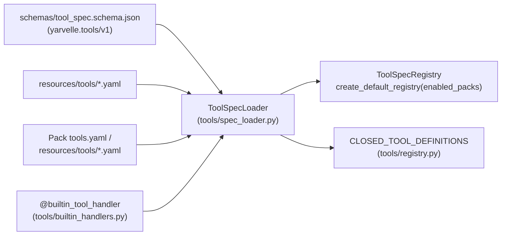

# ADR-0012: Declarative MCP & Built-in Tool Specifications (`yarvelle.tools/v1`)

<!--
  Yarvelle Core — Domain-Neutral AI Agent Runtime & Execution Engine
  Copyright 2026 Spectrayan (https://spectrayan.com)

  Licensed under the PolyForm Noncommercial License 1.0.0 and the
  Yarvelle Core Additional Terms (see LICENSE and ADDITIONAL-TERMS.md).
  Personal and household local use only. Commercial use, hosted service
  offering, rebranding, white-labeling, and redistribution of modified
  forks are prohibited without a written commercial license from Spectrayan.

  Required Notice: Copyright 2026 Spectrayan (https://spectrayan.com)
-->

## Metadata

| Property | Value |
|---|---|
| **Status** | `Accepted (Implemented)` |
| **Date** | 2026-11-11 |
| **Authors** | Spectrayan Architecture Working Group (AWG) (`architecture@spectrayan.com`) |
| **Deciders** | Yarvelle Core Maintainers, Architecture Working Group |
| **Consulted** | Technical Lead & TSC Chair, Security Engineering Reviewers |
| **Informed** | Downstream Pack Authors & Sibling Runtime Maintainers |
| **Related** | [ADR-0002](0002-dynamic-mcp-db-toolbox.md), [ADR-0006](0006-policy-approvals-and-resume.md) |

---

## Context & Problem Statement

While SQL-backed tools in `yarvelle-core` were already loaded declaratively via `resources/db_tools.yaml` (`McpDatabaseToolbox`, [ADR-0002](0002-dynamic-mcp-db-toolbox.md)), the 18 non-SQL built-in and MCP tools were constructed imperatively inside `engine/tool_registry.py` alongside a drifted secondary dictionary (`CLOSED_TOOL_DEFINITIONS` in `tools/registry.py`) and an incomplete `ClosedToolName` literal in `schemas/tool.py`. Furthermore, `create_default_registry(enabled_packs=...)` accepted `enabled_packs` without filtering pack-scoped tool registrations, and sibling runtimes lacked a canonical JSON Schema contract (`schemas/tool_spec.schema.json`) for sharing tool definitions.

---

## Decision Drivers

- **Single Source of Truth**: Eliminate schema, description, and type-literal drift between `engine/tool_registry.py`, `tools/registry.py`, and `schemas/tool.py`.
- **Polyglot Contract**: Publish a versioned JSON Schema Draft 2020-12 contract (`apiVersion: yarvelle.tools/v1`, `schemas/tool_spec.schema.json`) consumable by Python domain packs and sibling Rust/TypeScript runtimes.
- **Reserved Context Hygiene**: Guarantee server-bound context parameters (`profile_id`, `user_id`, `locale`, `now`, `scope`) can never be injected or overridden via LLM-facing `input_schema`.
- **Build-Time Handler Parity**: Enforce 1:1 parity between declarative tool specifications and async Python handlers without starting network servers.
- **Strict Pack Gating**: Filter pack-contributed tools deterministically by `enabled_packs` inside `create_default_registry`.

---

## Considered Options

### Option 1: Keep Imperative `ToolSpec(...)` Constructors in Python
* **Description**: Continue defining JSON Schemas, descriptions, risk tiers, and egress allowlists in `engine/tool_registry.py`.
* **Pros**:
  - Single-language locality.
* **Cons**:
  - High boilerplate (~625 lines of inline dicts), frequent description drift, and zero portability to non-Python runtimes.

### Option 2: Monolithic Single-File YAML Catalog
* **Description**: Place every core tool into a single large `tools.yaml`.
* **Pros**:
  - Single file to open.
* **Cons**:
  - Merge conflicts across concurrent PRs touching unrelated tool families.

### Option 3: Category-Scoped Declarative YAML/JSON Manifests + `ToolSpecLoader` (Chosen)
* **Description**: Define `ToolSetManifest` (`apiVersion: yarvelle.tools/v1`, `kind: ToolSet`) in `yarvelle_core.schemas.tool_spec`, export `schemas/tool_spec.schema.json`, store core tool specs under `yarvelle_core/resources/tools/*.yaml`, keep thin `@builtin_tool_handler` async functions in `yarvelle_core/tools/builtin_handlers.py`, and enforce 1:1 parity in CI.
* **Pros**:
  - Zero schema duplication, polyglot JSON Schema validation, clean git diffs per tool category, and strict handler parity.
* **Cons**:
  - Adding a new `kind: handler` tool requires updating both a YAML spec and an async handler (enforced automatically by contract tests).

---

## Decision Outcome

**Chosen Option**: **Option 3: Category-Scoped Declarative YAML/JSON Manifests + `ToolSpecLoader`**

### Architectural Diagram



---

## Consequences

### Positive Consequences
- Removed ~625 lines of inline JSON Schema dictionaries and closures from `engine/tool_registry.py` and eliminated two upward import-linter exceptions.
- `CLOSED_TOOL_DEFINITIONS` and `ClosedToolName` derive from and match the canonical declarative catalog.
- `create_default_registry(enabled_packs=...)` deterministically filters pack-scoped tools.
- `test_tool_spec_schema_validation.py` fails CI on invalid JSON Schemas, reserved context parameter leaks, missing handlers, or orphaned handlers.

### Negative Consequences
- Handler entrypoints (`module:function`) are resolved dynamically by `ToolSpecLoader` and therefore require build-time contract tests to catch typos early.

### Neutral / Preserved Behaviors
- `McpDatabaseToolbox` (`resources/db_tools.yaml`), `ToolExecutionGate` 4-tier policy evaluation, and `ToolSpec` public attributes remain backward compatible.

---

## Verification & Code References

- **Canonical Schema & Models**: `schemas/tool_spec.schema.json`, `backend/src/yarvelle_core/schemas/tool_spec.py`
- **Loader & Built-in Handlers**: `backend/src/yarvelle_core/tools/spec_loader.py`, `backend/src/yarvelle_core/tools/builtin_handlers.py`
- **Declarative Core Tool Catalog**: `backend/src/yarvelle_core/resources/tools/*.yaml`
- **Registry Integration**: `backend/src/yarvelle_core/engine/tool_registry.py`, `backend/src/yarvelle_core/tools/registry.py`
- **Contract Tests**: `backend/tests/test_tool_spec_schema_validation.py`
- **Verification Command**:
  ```bash
  PYTHONPATH=backend/src uv run --project backend pytest backend/tests/test_tool_spec_schema_validation.py
  ```
