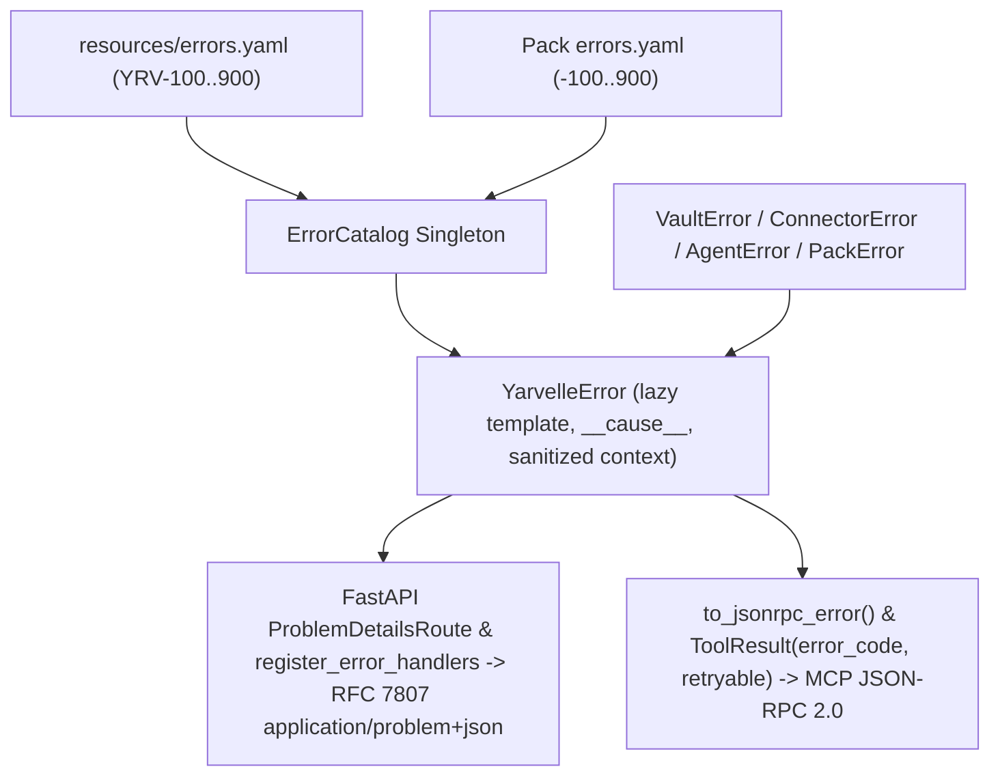

# ADR-0013: Immutable Unified Error Taxonomy (`YRV-XXX-YYY`), RFC 7807 Problem Details, and MCP JSON-RPC Mapping

<!--
  Yarvelle Core — Domain-Neutral AI Agent Runtime & Execution Engine
  Copyright 2026 Spectrayan (https://spectrayan.com)

  Licensed under the PolyForm Noncommercial License 1.0.0 and the
  Yarvelle Core Additional Terms (see LICENSE and ADDITIONAL-TERMS.md).
  Personal and household local use only. Commercial use, hosted service
  offering, rebranding, white-labeling, and redistribution of modified
  forks are prohibited without a written commercial license from Spectrayan.

  Required Notice: Copyright 2026 Spectrayan (https://spectrayan.com)
-->

## Metadata

| Property | Value |
|---|---|
| **Status** | `Accepted (Implemented)` |
| **Date** | 2026-11-11 |
| **Authors** | Spectrayan Architecture Working Group (AWG) (`architecture@spectrayan.com`) |
| **Deciders** | Yarvelle Core Maintainers, Architecture Working Group |
| **Consulted** | Technical Lead & TSC Chair, Security Engineering Reviewers |
| **Informed** | Yarvelle Open-Source Community, Downstream Domain Pack Maintainers |

---

## Context & Problem Statement

Prior to this decision, `yarvelle-core` suffered from fragmented error handling across its HTTP REST layer, subsystem exception classes, and MCP/tool execution pipeline:

1. **Mutable Slug-Only Catalog**: `backend/src/yarvelle_core/resources/errors.yaml` mapped 33 mutable snake_case slugs to `{status_code, message, description}` without immutable numeric identifiers, category blocks, `retryable` flags, or JSON-RPC error codes.
2. **Ad-Hoc `HTTPException` Raises & Information Leakage**: Across `yarvelle_core/api/*.py`, `HTTPException` was raised 201 times with raw English `detail` strings (and in several `500` handlers, `detail=str(err)`), forcing UI and CLI callers to substring-match human prose while risking internal exception disclosure.
3. **Disconnected Subsystem Exceptions**: `yarvelle_core/vault/errors.py`, `yarvelle_core/connectors/errors.py`, and `yarvelle_core/agents/errors.py` defined standalone exception hierarchies with no shared base class, HTTP status, retryability signal, or MCP protocol mapping.
4. **Unstructured Tool Failures**: `ToolResult(ok=False, error=...)` carried only a human-readable string, preventing workflow nodes and circuit breakers from distinguishing transient `502`/`503`/`504` transport timeouts (`retryable=True`) from permanent `400`/`403`/`404` policy or validation denials (`retryable=False`).

---

## Decision Drivers

- **Immutability Contract**: Once published, an error code (`YRV-XXX-YYY`) must never be deleted or reassigned so client handlers, telemetry dashboards, and audit alerts never break silently.
- **Standards-Compliant Protocol Mappers**: REST endpoints must emit RFC 7807 Problem Details (`application/problem+json`) while preserving top-level `"detail"` compatibility for existing HTTP clients; MCP and tool paths must emit deterministic JSON-RPC 2.0 error objects.
- **Deterministic Retryability**: Every error code must explicitly classify `retryable: bool` to drive upstream connector retries and circuit breakers without string matching.
- **Strict Domain Neutrality & Pack Extensibility**: Core reserves the `YRV` prefix exclusively; downstream domain packs must be able to register disjoint `<PREFIX>-XXX-YYY` catalogs through the same loader and protocol mappers.
- **Zero Sensitive Data Leakage**: Context payloads must automatically redact secret keys (`password`, `token`, `api_key`, `kek`, `dek`), and `500` handlers must never expose raw internal exception text.

---

## Considered Options

### Option 1: Keep FastAPI `HTTPException` and Add Custom Header Codes
* **Description**: Continue raising `HTTPException(status_code=..., detail=...)` and attach an `X-Error-Code` response header on selected endpoints.
* **Pros**:
  - Minimal code churn across existing routers.
* **Cons**:
  - Does not conform to RFC 7807 (`application/problem+json`).
  - Leaves MCP/JSON-RPC tool execution and subsystem exceptions (`VaultError`, `ConnectorError`, `AgentNotFoundError`) unmapped.

### Option 2: Centralize All Domain & Pack Error Codes in `yarvelle-core`
* **Description**: Place both core runtime codes and downstream vertical domain codes inside a single monolithic `errors.yaml` in `yarvelle-core`.
* **Pros**:
  - Single file lookup for all error codes.
* **Cons**:
  - Violates the foundational "Core Knows No Domain" invariant enforced by `lint-imports` and neutrality scans.

### Option 3: Immutable `YRV-XXX-YYY` Catalog, `YarvelleError` Hierarchy, RFC 7807 + JSON-RPC Mappers, and Disjoint Pack Prefixes (Chosen)
* **Description**: Upgrade `resources/errors.yaml` (`apiVersion: yarvelle.errors/v1`) into a 9-block `YRV-XXX-YYY` catalog (`100` Validation through `900` Internal), introduce `yarvelle_core.errors.YarvelleError` with lazy `{}` formatting and sanitized `context`, unify subsystem exceptions, install RFC 7807 `ProblemDetailsRoute` + `register_error_handlers`, enrich `ToolResult` with `error_code` and `retryable`, and expose `register_pack_error_catalog` for disjoint `<PREFIX>-XXX-YYY` pack catalogs.
* **Pros**:
  - Satisfies RFC 7807 and JSON-RPC 2.0 protocol standards from a single declarative source of truth.
  - Preserves backward compatibility (`detail` field in Problem Details JSON, legacy slug lookup in `format_error`, `ProblemDetailsRoute` working even when `api_router` is mounted on bare host `FastAPI()` instances).
  - Enforces strict foundation-layer purity (`yarvelle_core.errors` has zero upward imports).
* **Cons**:
  - Requires migrating all 201 `HTTPException` sites across `yarvelle_core/api/*.py` and enforcing CI uniqueness/immutability tests.

---

## Decision Outcome

**Chosen Option**: **Option 3: Immutable `YRV-XXX-YYY` Catalog, `YarvelleError` Hierarchy, RFC 7807 + JSON-RPC Mappers, and Disjoint Pack Prefixes**

### Numeric Category Blocks

| Block | Category | Scope |
|---|---|---|
| `100` | `validation` | Request parameters, state transitions, media constraints, locale tags |
| `200` | `configuration` | Manifest schemas, YAML syntax, model providers, pack loading |
| `300` | `auth` | Authentication, RBAC, profile access, `ScopeContext`, CSRF, policy gates |
| `400` | `vault` | KEK/DEK lifecycle, envelope encryption, key derivation, sealed audit fields |
| `500` | `storage` | Relational lookups, CAS blobs, memory records, uniqueness conflicts |
| `600` | `connector` | Egress firewall, OAuth PKCE state, upstream gateway/model timeouts |
| `700` | `mcp_tools` | Tool registry, human-in-the-loop approvals, MCP schema pins & transport |
| `800` | `workflow` | Agent/skill catalog, conversation threads, safety guardrails, grounding |
| `900` | `internal` | Unclassified internal runtime failures (`retryable: false`, sanitized detail) |

### Architectural Diagram



---

## Consequences

### Positive Consequences
- **Machine-Parseable Client Contracts**: Every HTTP error response emits `application/problem+json` with `type`, `title`, `status`, `detail`, `instance`, `code`, `slug`, `retryable`, and sanitized `context`.
- **Deterministic Circuit Breakers & Retries**: Connectors and workflow nodes inspect `err.retryable` / `tool_result.retryable` directly instead of parsing strings.
- **Zero Raw `500` Exception Leakage**: Unclassified exceptions log server-side and return sanitized `YRV-900-001` / `YRV-500-013` / `YRV-500-014` responses.

### Negative Consequences
- Direct Python unit tests calling FastAPI endpoint coroutines without an ASGI client catch `YarvelleError` instead of `fastapi.HTTPException`.

### Neutral / Preserved Behaviors
- Existing HTTP clients reading `response.json()["detail"]` continue to work unchanged because RFC 7807 Problem Details defines `"detail"` as a top-level string member.
- Host applications mounting `api_router` onto a bare `FastAPI()` instance automatically receive RFC 7807 Problem Details via `ProblemDetailsRoute`, and can also call `register_error_handlers(app)` or `create_app()` for app-wide coverage.

---

## Verification & Code References

- **Declarative Error Catalog**: `backend/src/yarvelle_core/resources/errors.yaml`
- **Core Taxonomy & Exception Hierarchy**: `backend/src/yarvelle_core/errors/catalog.py`, `backend/src/yarvelle_core/errors/base.py`
- **Subsystem Bridges**: `backend/src/yarvelle_core/vault/errors.py`, `backend/src/yarvelle_core/connectors/errors.py`, `backend/src/yarvelle_core/agents/errors.py`, `backend/src/yarvelle_core/pack/loader.py`
- **FastAPI & MCP Protocol Mappers**: `backend/src/yarvelle_core/api/errors.py`, `backend/src/yarvelle_core/api/app.py`, `backend/src/yarvelle_core/schemas/tool.py`, `backend/src/yarvelle_core/engine/tool_exec.py`
- **Unit & Contract Tests**: `backend/tests/test_error_taxonomy.py`
- **Verification Command**:
  ```bash
  PYTHONPATH=backend/src backend/.venv/bin/pytest backend/tests/test_error_taxonomy.py -v
  ```
