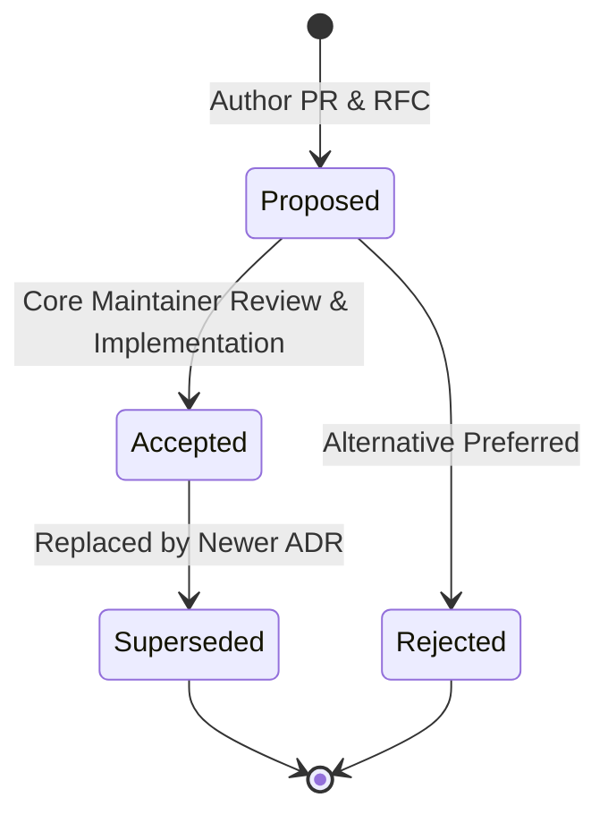

# Architecture Decision Records (ADRs)

**Yarvelle Core** uses **Architecture Decision Records (ADRs)** to document significant architectural, design, and security decisions made throughout the evolution of the domain-neutral agent runtime and multi-domain isolation framework.

Our ADR system is modeled after the **Spector Living ADR Framework**, ensuring that all architectural choices are transparent, historical, and directly verified against working code.

---

## ADR Lifecycle & Statuses

Every ADR moves through a structured lifecycle:

| Status | Definition |
|---|---|
| **`Proposed`** | The decision is under active review by maintainers and the Architecture Working Group (AWG). |
| **`Accepted (Implemented)`** | The decision has been approved, merged, and fully verified against production code. |
| **`Superseded`** | A subsequent ADR has replaced or significantly amended this decision (links to newer ADR). |
| **`Rejected`** | The proposal was evaluated but not adopted. Retained for historical record. |

---

## Immutability & Contribution Rules

1. **Historical Immutability**: Once an ADR is marked `Accepted (Implemented)`, its original problem statement, evaluated options, and trade-off analysis must never be rewritten.
2. **Amending Decisions**: If an architectural requirement changes, do not edit the accepted ADR. Instead, author a new ADR that explicitly marks the earlier record as `Superseded by ADR-XXXX`.
3. **Domain-Neutrality Invariant**: All `yarvelle-core` ADRs must preserve the core architectural boundary ("Core Knows No Domain"): dependencies flow strictly `Applications -> Domain Packs -> Yarvelle Core`.
4. **Template Compliance**: All new proposals must start from [`0000-template.md`](0000-template.md) and include:
   - Metadata table (`Status`, `Date`, `Authors`, `Deciders`, `Consulted`, `Informed`, `Related`).
   - Context & Problem Statement.
   - Decision Drivers.
   - Considered Options with pros/cons.
   - Decision Outcome with Mermaid architectural diagrams.
   - Consequences (Positive, Negative, Neutral).
   - Verification & Code References.

---

## ADR Index

| ADR # | Title | Status | Date | Primary Code References |
|---|---|---|---|---|
| **[0000](0000-template.md)** | Architecture Decision Record Template | `Accepted` | 2026-10-02 | — |
| **[0001](0001-multi-agent-deliberation.md)** | Multi-Agent Deliberation (`ExecutionMode.DELIBERATE`) | `Accepted (Implemented)` | 2026-10-24 | `yarvelle_core/workflows/deliberation/`, `yarvelle_core/schemas/plan.py` |
| **[0002](0002-dynamic-mcp-db-toolbox.md)** | Dynamic Multi-Dialect MCP Database Toolbox, M-Schema Catalog, and AST Sandbox | `Accepted (Implemented)` | 2026-10-25 | `yarvelle_core/db/schema_catalog.py`, `yarvelle_core/tools/sql_ast_sandbox.py`, `yarvelle_core/tools/mcp_db_toolbox.py`, `yarvelle_core/workflows/subgraphs/db_toolbox/` |
| **[0003](0003-orchestrator-driven-agent-architecture.md)** | Orchestrator-Driven Multi-Agent Architecture | `Accepted (Implemented)` | 2026-10-02 | `yarvelle_core/workflows/`, `yarvelle_core/loaders/` |
| **[0004](0004-hexagonal-memory-and-catalog-ports.md)** | Hexagonal Memory & Catalog Ports Architecture | `Accepted (Implemented)` | 2026-10-02 | `yarvelle_core/memory/ports/`, `yarvelle_core/memory/adapters/sqlite/` |
| **[0005](0005-progressive-disclosure-skill-context-management.md)** | Progressive Disclosure & Deep Agents Context Management | `Accepted (Implemented)` | 2026-10-02 | `yarvelle_core/engine/`, `skills/*/SKILL.md`, `agents/*/` |
| **[0006](0006-policy-approvals-and-resume.md)** | Policy Approvals, Single-Use Tokens, and Atomic Resumption | `Accepted (Implemented)` | 2026-10-12 | `yarvelle_core/engine/tool_exec.py`, `yarvelle_core/api/approvals.py`, `yarvelle_core/db/models.py` |
| **[0007](0007-vault-threat-model-and-kek-sources.md)** | Cryptographic Keyring Vault Threat Model & KEK Hierarchy | `Accepted (Implemented)` | 2026-10-12 | `yarvelle_core/vault/crypto.py`, `yarvelle_core/vault/kek.py`, `yarvelle_core/vault/dek.py` |
| **[0008](0008-deployment-modes-and-requirement-tiers.md)** | Deployment Modes (Mode L vs Mode S) and Requirement Tiers | `Accepted (Implemented)` | 2026-10-12 | `yarvelle_core/config.py`, `scripts/` |
| **[0009](0009-content-addressed-storage-and-hybrid-search.md)** | Content-Addressed Storage, Deduplication, and Hybrid Search Protocol | `Accepted (Implemented)` | 2026-10-12 | `yarvelle_core/storage/`, `yarvelle_core/memory/`, `yarvelle_core/search/` |
| **[0010](0010-oauth-relay-and-stateless-callback.md)** | Stateless OAuth 2.0 PKCE Callback Bounce Relay & Zero-Token Handoff | `Accepted (Implemented)` | 2026-10-14 | `yarvelle_core/connectors/oauth.py`, `yarvelle_core/api/connections.py` |
| **[0011](0011-internationalization-and-multilingual-architecture.md)** | Multi-Layer Internationalization (i18n), Unicode UAX #15 NFC Storage, and Multilingual Safety Architecture | `Accepted (Implemented)` | 2026-10-14 | `yarvelle_core/i18n/`, `frontend/src/lib/i18n/` |
