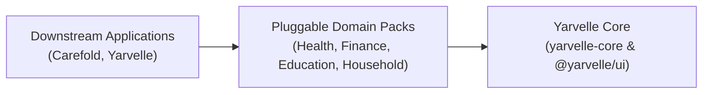

# Yarvelle Core

**Domain-Neutral AI Agent Runtime, Multi-Agent Deliberation Engine & 11-Layer Scope Isolation Framework**

`yarvelle-core` is the domain-neutral execution engine and shared UI design system (`@yarvelle/ui`) that powers downstream domain applications (including **Carefold** and **Yarvelle**) via pluggable domain packs (`PackSpec` / `pack.yaml`).

---

## Core Architectural Principles

1. **Strict Domain Neutrality ("Core Knows No Domain")**: Dependencies flow strictly inward (`Applications -> Domain Packs -> Yarvelle Core`). Zero domain-specific vocabulary exists in `yarvelle-core` (enforced continuously by `test_neutral_words_scan.py`).
2. **Four Deterministic Execution Topologies**:
   - `SINGLE`: Single specialist agent execution with bounded tool loops.
   - `PARALLEL`: Concurrent multi-specialist fan-out via `asyncio.gather`.
   - `PIPELINE`: Topologically sorted DAG forwarding prior outputs downstream.
   - `DELIBERATE`: Bounded multi-round scoped blackboard deliberation with **Disagree-or-Commit (DoC)** peer critique and deterministic constraint budget auditing ([ADR-0001](adr/0001-multi-agent-deliberation.md)).
3. **Dynamic Multi-Dialect MCP Database Toolbox**:
   - M-Schema introspection catalog (`SchemaCatalog`) with 100% table, column, and index comment coverage, 5-stage `sqlglot` AST sandbox (`SELECT`, `INSERT`, `UPDATE`, `DELETE` only; zero DDL), mandatory `profile_id` + `scope` predicate rewriting, and dialect transpilation across SQLite, PostgreSQL, MySQL/MariaDB, SQL Server, and DuckDB ([ADR-0002](adr/0002-dynamic-mcp-db-toolbox.md)).
4. **11-Layer Scope Isolation & 4-Tier Policy Gate**:
   - Every turn and tool call executes inside an explicit `ScopeContext` across `ScopedSession` ORM queries, partitioned CAS storage ([ADR-0009](adr/0009-content-addressed-storage-and-hybrid-search.md)), scoped FTS5/vector search, memory namespaces ([ADR-0004](adr/0004-hexagonal-memory-and-catalog-ports.md)), and HKDF-SHA256 AES-256-GCM keyring vaults ([ADR-0007](adr/0007-vault-threat-model-and-kek-sources.md)).
   - All tools traverse a 4-tier policy gate (`read`, `write_local`, `write_external`, `irreversible`) with monotone taint tracking and single-use human approvals ([ADR-0006](adr/0006-policy-approvals-and-resume.md)).

---

## Architecture Decision Records (ADRs)

Explore the full [ADR Index](adr/README.md):

- **[ADR-0000](adr/0000-template.md)**: Architecture Decision Record Template
- **[ADR-0001](adr/0001-multi-agent-deliberation.md)**: Multi-Agent Deliberation (`ExecutionMode.DELIBERATE`)
- **[ADR-0002](adr/0002-dynamic-mcp-db-toolbox.md)**: Dynamic Multi-Dialect MCP Database Toolbox, M-Schema Catalog, and AST Sandbox
- **[ADR-0003](adr/0003-orchestrator-driven-agent-architecture.md)**: Orchestrator-Driven Multi-Agent Architecture
- **[ADR-0004](adr/0004-hexagonal-memory-and-catalog-ports.md)**: Hexagonal Memory & Catalog Ports Architecture
- **[ADR-0005](adr/0005-progressive-disclosure-skill-context-management.md)**: Progressive Disclosure & Deep Agents Context Management
- **[ADR-0006](adr/0006-policy-approvals-and-resume.md)**: Policy Gate, Monotone Taint Propagation, and Atomic Single-Use Approvals Resume
- **[ADR-0007](adr/0007-vault-threat-model-and-kek-sources.md)**: Cryptographic Keyring Vault Threat Model, Key Hierarchy, and KEK Resolution Sources
- **[ADR-0008](adr/0008-deployment-modes-and-requirement-tiers.md)**: Dual Deployment Modes (Mode L & Mode S) and Two-Tier Requirement Standards
- **[ADR-0009](adr/0009-content-addressed-storage-and-hybrid-search.md)**: Content-Addressed Storage Layout, Fail-Closed Profile Scoping, and Hybrid SearchIndex Architecture
- **[ADR-0010](adr/0010-oauth-relay-and-stateless-callback.md)**: Stateless OAuth 2.0 PKCE Callback Bounce Relay & Zero-Token Handoff
- **[ADR-0011](adr/0011-internationalization-and-multilingual-architecture.md)**: Multi-Layer Internationalization (i18n), Unicode UAX #15 NFC Storage, and Multilingual Safety Architecture
